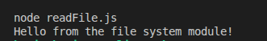
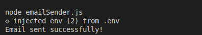
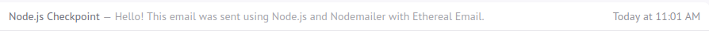

# GMC Node.js Modules Checkpoint

This project demonstrates the use of built-in, local, and third-party modules in Node.js.

## Task 1: Built-in Module (fs)

Reads and displays the contents of `message.txt`.

## Task 2: Local Module

Generates a student report with an average score and pass/fail status.

## Task 3: Third-Party Module (Nodemailer)

Uses Nodemailer and Ethereal Email to send and preview a test email.

`

**Note:** Email credentials are stored in `.env`. This file is excluded from GitHub for security.
